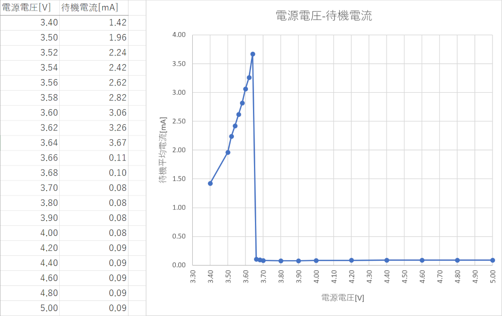

# KB6 電源電圧が低いと待機電流が増える

## 事象

電源電圧が3.7Vのときは待機電流は100uA以下だが、電源電圧が3.6Vに下がると約3.6mAと大幅に増えた。

## 原因

正常な動作です。

電源電圧が低いと電源ICの動作が切り替わり、電源ICで消費電流が増えます。

> [9.4.2 Power Save Mode Operation (PWM/PFM)](https://www.ti.com/document-viewer/ja-jp/TPS62148/datasheet#GUID-6AA964CC-336E-4879-B3C4-8154492186E2/TITLE-SLVSDR8SLVSDR85219)
>
> There is a minimum off-time which limits the duty cycle of the TPS62147, TPS62148. When VIN decreases to typically 15% above VOUT, the TPS62147, TPS62148 does not enter Power Save Mode, regardless of the load current. The device maintains output regulation in PWM mode.

Wio BG770A v1.1で電源電圧を変えながら待機電流を測定したところ、3.66V未満で待機電流が多くなりました。

  

## 回避策

### 回避策1

電源電圧を3.8V以上（3.3V * 1.15）にする。

### 回避策2

Wio BG770Aの電源ICを使用しない。
（JP13のハンダを除去し、J5から3.3Vを供給する。）

## 参考リンク

* [3.6V入力時、PSM待機時の消費電流が3.6mAまで増大する](https://github.com/SeeedJP/wio_cellular/issues/68)
