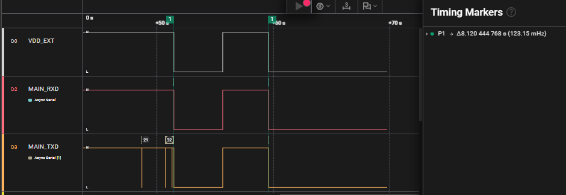

# KB7 PSMでセルラーモジュールが停止した直後は電源をオンにできません

## 事象

`WioCellular.setPsm()`でPSMを設定すると、一定時間後にモジュールが停止します。
モジュールが停止したかどうかは、`WioCellular.getInterface().isActive()`で確認できます。

しかし、停止を確認した直後に`WioCellular.powerOn()`を呼び出しても、モジュールの電源はオンになりません。

## 原因

正常な動作です。

セルラーモジュールのデータシートには記載されていませんが、PSMによる停止時には、`WioCellular.getInterface().isActive()`の戻り値がtrue → false → true → falseと変化します。
つまり、一度停止したように見えた後、一時的にアクティブ状態に戻ってから、再び停止する動作が見られます。

`WioCellular.getInterface().isActive()`は、VDD_EXTの状態を返します。実測したところ、モジュールが完全に停止するまでには、8.12秒かかっています。

  

## 回避策

PSMを使用しているときは、`WioCellular.getInterface().isActive()`がfalseになったことを確認してから、最低10秒以上は時間をおいてから`WioCellular.powerOn()`を呼び出してください。

## 参考リンク

* [VDD_EXT割り込み内でUARTの begin() / end() を呼ばないようにしたい](https://github.com/SeeedJP/wio_cellular/issues/67)
